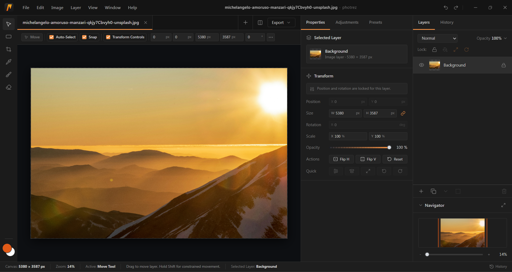

<p align="center">
  
</p>

<h1 align="center">
  <strong>Photrez</strong>
</h1>

<p align="center">
  <strong>A fast, lightweight desktop image editor for daily graphic work.</strong><br>
  Layer management, transforms, precision selection, brush tools, and print export — built for creators who want clean, dependable editing without the bloat.
</p>

<p align="center">
  <a href="https://github.com/photrez/photrez/actions/workflows/ci.yml"></a>
  <a href="https://github.com/photrez/photrez/releases"></a>
  <a href="https://github.com/photrez/photrez/blob/main/LICENSE"></a>
  <a href="https://github.com/photrez/photrez/stargazers"></a>
  <a href="https://github.com/photrez/photrez/issues"></a>
  
</p>

---



<div align="center">

### 📦 Download Photrez for Windows

**[⬇️ Download Photrez v0.1.0 (.exe Setup)](https://github.com/photrez/photrez/releases/download/v0.1.0/Photrez_0.1.0_x64-setup.exe)**
<br>
*Supports Windows 10 & 11 (64-bit)*

</div>

> ℹ️ **SmartScreen Notice:** The installer is currently not code-signed with a commercial certificate. If Windows SmartScreen displays a warning upon launch, click **"More info"** and then **"Run anyway"**.

> The Tauri/SolidJS-era source and its full history are preserved at [photrez/photrez-legacy](https://github.com/photrez/photrez-legacy) - a frozen, read-only archive. The current release (v0.1.0) is built on that same stack; the planned v0.2.0 "Native Update" replaces the web-view shell (see the roadmap below).

---

## ✨ Key Features

<table>
  <tr>
    <td width="50%" valign="top">
      <h3>⚡ Lightweight & Fast</h3>
      <p>Starts near-instantly with a compact <b>~5MB installer</b> and minimal <b>~34MB idle RAM</b> usage. No background telemetry or forced cloud accounts.</p>
    </td>
    <td width="50%" valign="top">
      <h3>🎨 Layer & Selection Workflow</h3>
      <p>Full multi-layer management (opacity, visibility, lock, duplicate, merge), marquee selection tools (rectangle & ellipse), and object transforms.</p>
    </td>
  </tr>
  <tr>
    <td width="50%" valign="top">
      <h3>🖌️ Calibrated Paint & Vector</h3>
      <p>Smooth round-tip brush and eraser with hardness, flow, and smoothing controls, alongside native vector text and shape layers.</p>
    </td>
    <td width="50%" valign="top">
      <h3>🖨️ Pro Print & High-DPI Export</h3>
      <p>Built-in print preview inspector with paper presets, DPI/PPI scale calculations, and clean exports to PNG, JPEG, and WebP.</p>
    </td>
  </tr>
</table>

---

## 📁 Supported Formats

| Format | Extension | Type | Import | Export | Notes |
| --- | --- | --- | :---: | :---: | --- |
| **Photrez Project** | `.ptz` | Native Project | ✅ | ✅ | Backward-compatible from v0.1.0; current format v3, preserves full layer state & vector text |
| **PNG Image** | `.png` | Raster Bitmap | ✅ | ✅ | Full RGBA alpha channel transparency support |
| **JPEG Image** | `.jpg`, `.jpeg` | Raster Bitmap | ✅ | ✅ | Standard compressed photo format with quality controls |
| **WebP Image** | `.webp` | Raster Bitmap | ✅ | ✅ | Modern web image format (lossless & lossy) |

---

## ⌨️ Essential Keyboard Shortcuts

| Shortcut | Tool / Action | Description |
| --- | --- | --- |
| `V` | **Move & Transform** | Select, drag, scale, and rotate objects |
| `M` / `Shift+M` | **Marquee Selection** | Toggle between Rectangular and Elliptical marquee |
| `B` / `E` | **Brush & Eraser** | Paint strokes or erase bitmap layer pixels |
| `T` / `U` | **Text & Shape** | Add typography layers or draw vector shapes |
| `Ctrl + Z` / `Ctrl + Y` | **Undo / Redo** | History stack navigation |
| `Ctrl + Shift + P` | **Print Inspector** | Open Pro-Suite paper setup & DPI preview |

---

## 🗺️ Release Roadmap

- [x] **`v0.1.0` — Stable MVP** *(released 2026-08-06)* — Complete editing toolkit; `.ptz` is backward-compatible from this release (current format v3).
- [ ] **`v0.2.0` — The Native Update** *(in development)*
  - ✅ **Text layers** — live, re-editable text on the canvas (`T`)
  - ✅ **Shape layers** — rectangle, ellipse, line, arrow, star; editable until rasterized (`U`)
  - ✅ **All 12 blend modes** — preview/export parity verified
  - 🚧 **Native Rust UI** — planned replacement for the Tauri web-view shell. Not yet implemented or shipped; installer/performance claims await measurement.
- [ ] **`v0.3.0` (planned)** — Floating and detachable inspector panels.
- [ ] **`v0.4.0` (planned)** — Multi-image windows.
- [ ] **`v1.0.0` (planned)** — Full cross-platform release (Windows, macOS, Linux).

---

## 💡 Why Photrez?

Photrez is a lightweight desktop image editor for practical digital and print workflows:

- **Local-first editing:** Your work stays on your machine; no cloud account is required.
- **A complete editing toolkit:** Layers, text, shapes, selection, brush tools, transforms, print settings, and export.
- **The Native Update:** v0.1.0 ships on Tauri 2 with the operating system's web-view runtime. The planned 0.2.0 release moves the interface to a native Rust UI; performance and installer claims will follow measurement.
- **Open source:** Licensed under AGPL-3.0-or-later.

<p align="center">
  
  
  
  
  
  
  
</p>
---

## 🛠️ Developer Quick Start

> **2026-10-17:** this source tree no longer builds the v0.1.0 desktop app — the
> browser-side runtime was removed ahead of the native rewrite (see the roadmap
> above). The v0.1.0 sources and build instructions live in the frozen archive
> at [photrez/photrez-legacy](https://github.com/photrez/photrez-legacy).

```bash
# 1. Clone repository & install dependencies
bun install

# 2. Run the frontend unit suite (the JS suite this tree still runs)
bun run --filter photrez-desktop test:unit
```

---

## ❓ Frequently Asked Questions (FAQ)

<details>
<summary><b>Why is the v0.1.0 installer small (~5MB)?</b></summary>
<p>The v0.1.0 release uses Tauri 2 with the operating system's WebView2 runtime. The planned 0.2.0 native Rust UI uses a different runtime; its installer size will be measured before release.</p>
</details>

<details>
<summary><b>Does Photrez require an internet connection or account?</b></summary>
<p>No. Photrez is 100% local-first software. It runs entirely offline on your computer without cloud accounts, telemetry, or subscriptions.</p>
</details>

<details>
<summary><b>Does Photrez support PSD files?</b></summary>
<p>Not currently. Photrez uses its versioned <code>.ptz</code> project format for layered documents and exports to PNG, JPEG, and WebP. PSD import support is on the long-term roadmap.</p>
</details>

<details>
<summary><b>What do Save, Save As, and Export do?</b></summary>
<p><b>Save</b> (<code>Ctrl+S</code>) overwrites your <code>.ptz</code> project — every layer, fully re-editable later. For a new or unsaved document it opens Save As, which defaults to <code>.ptz</code>. A flat single-layer source (JPG/PNG/WebP) is overwritten in place by Save. <b>Export</b> (<code>Ctrl+Alt+E</code>) writes a separate flat PNG/JPEG/WebP copy.</p>
</details>

<details>
<summary><b>Is there autosave, and what happens after a crash?</b></summary>
<p>Yes. While you edit, Photrez writes a hidden autosave — document metadata plus pixels — at most once per minute to a local temp directory, and checks for it on the next launch. Recovery is silent in the current MVP (there is no "recover from autosave" dialog), and the autosave is cleaned up on a normal close. It is local-only — no cloud backup.</p>
</details>

<details>
<summary><b>What happens when I close a document with unsaved changes?</b></summary>
<p>Photrez asks <b>Discard changes?</b> — choose <b>Discard</b> to close without saving, or <b>Cancel</b> to go back. With nothing unsaved, the document closes immediately and the nearest remaining tab activates.</p>
</details>

<details>
<summary><b>What are the New Document defaults?</b></summary>
<p>New documents start at 1920×1080 on a white background (white, black, and transparent are offered), with presets for HD (1920×1080), Social Square (1080×1080), and A4 at 300 DPI (2480×3508) — or set a custom size.</p>
</details>

<details>
<summary><b>Why does the canvas look pixelated at very high zoom?</b></summary>
<p>The preview buffer is clamped at 4096px to prevent WebGL context loss on low-VRAM GPUs, so beyond that zoom level the preview pixelates. Pan to inspect other regions instead of zooming further.</p>
</details>

<details>
<summary><b>Why is the first "Apply &amp; Paint" on a large adjusted layer briefly slow?</b></summary>
<p>Baking an adjustment layer reads pixels back from the GPU synchronously — a 50–200ms hitch on 4K+ layers. An asynchronous (PBO) readback is planned for v1.0.</p>
</details>

<details>
<summary><b>Any other known limitations?</b></summary>
<p>The app CSP allows inline styles (required by the current Tailwind CSS v4 pipeline; scripts are unaffected — a hash-based CSP is planned for v1.0). A minor resize flash can still occur when restoring the window on a multi-monitor setup. For anything else, GitHub Issues is the live channel for bugs.</p>
</details>

---

## 📚 Documentation

- 🧭 **[Documentation Index](docs/INDEX.md)** — full documentation map
- 🏗️ **[Architecture](docs/ARCHITECTURE.md)** — runtime architecture & migration status
- 📋 **[Feature Checklist](docs/FEATURES.md)** — Full technical inventory
- 🤝 **[Contributing](CONTRIBUTING.md)** — PR & code guidelines
- 🔒 **[Security Policy](SECURITY.md)** — Vulnerability reporting

---

## 📄 License

Photrez is open-source software licensed under **AGPL-3.0-or-later**. See the [LICENSE](LICENSE) file for details.
