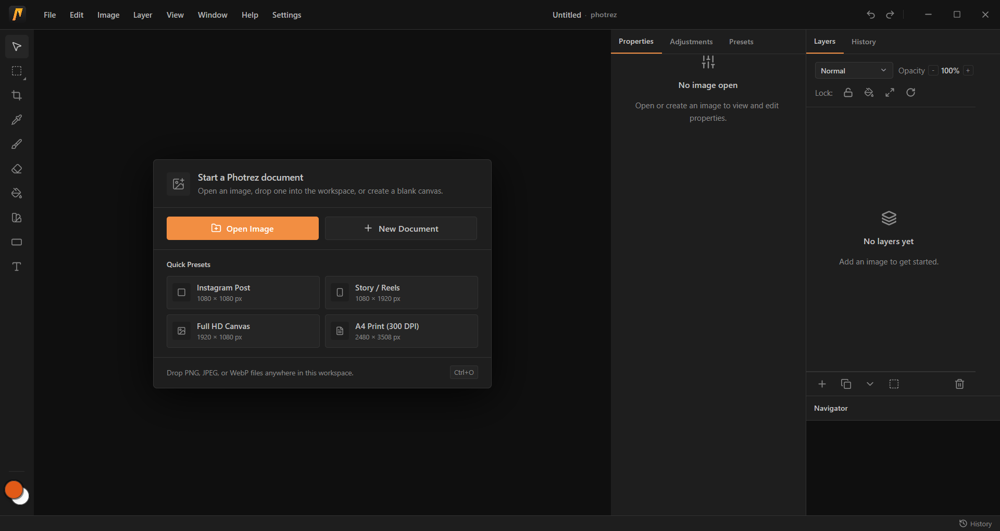
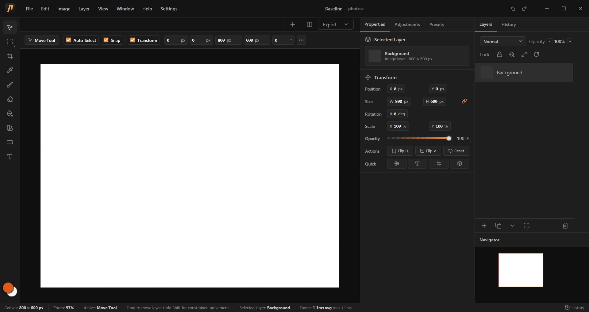

<p align="center">
  
</p>

<h1 align="center">Photrez</h1>

<p align="center">
  <b>A native image editor for layered work.</b><br>
  Raster layers, selections, transforms, text, shapes, print and export in one Rust application.<br>
  No embedded browser, no account, no telemetry.
</p>

<p align="center">
  <a href="https://github.com/photrez/photrez/actions/workflows/ci.yml"></a>
  
  
  
  
  <a href="LICENSE"></a>
</p>

<p align="center">
  <a href="#install">Install</a> &middot;
  <a href="#features">Features</a> &middot;
  <a href="#screenshots">Screenshots</a> &middot;
  <a href="#supported-formats">Formats</a> &middot;
  <a href="#build-from-source">Build</a> &middot;
  <a href="#documentation">Docs</a> &middot;
  <a href="#license">License</a>
</p>

<p align="center">
  
  <br>
  <sub>The native GPUI application at startup. Quick presets, panel dock, layer list and Navigator.</sub>
</p>

## What this is

Photrez is a local-first image editor written in Rust. GPUI draws the window, menus, canvas and panels. The `photrez-core` engine owns the document, pixels and history. The two parts share one process, so the UI projects core state and never becomes a second document authority.

It opens layered `.ptz` projects and common raster images, then exports flat PNG, JPEG or WebP files. The current native app is in alpha. The release page still lists the archived predecessor, so read the install note before you download.

## Features

<table>
  <tr>
    <td width="50%" valign="top">
      <h3>One native process</h3>
      <p>GPUI draws the window and the Rust core owns the document. There is no embedded browser, no JavaScript runtime and no IPC bridge in the product path.</p>
      <p>Document tabs keep their own camera. Pan, zoom, fit and actual size use the same camera model across tabs.</p>
    </td>
    <td width="50%" valign="top">
      <h3>Layers and history</h3>
      <p>Add, delete, rename, duplicate, merge, flatten, stamp and reorder layers. Set opacity, visibility, locks and one of twelve blend modes. The Layers row carries a live thumbnail.</p>
      <p>Undo and redo run through the core history. The History panel lists labelled steps and jumps to any one of them.</p>
    </td>
  </tr>
  <tr>
    <td width="50%" valign="top">
      <h3>Selections and transforms</h3>
      <p>Rectangle and ellipse marquees, Select All, Deselect, Invert, cut, copy, paste and delete pixels. Paste creates a layer, and a copied selection can move to another document.</p>
      <p>The Move tool drags, scales and rotates layers, snaps to canvas and layer edges, and shows guides during the drag.</p>
    </td>
    <td width="50%" valign="top">
      <h3>Paint, text and shapes</h3>
      <p>Brush and eraser with size, hardness, strength, flow and smoothing. Paint Bucket with tolerance and contiguous fill. Linear and radial gradients. Eyedropper with an optional auto-copy preference.</p>
      <p>Text layers stay re-editable in `.ptz`. Ten parametric shape kinds keep fill and stroke controls after drawing.</p>
    </td>
  </tr>
  <tr>
    <td width="50%" valign="top">
      <h3>Print and export</h3>
      <p>The print dialog and inspector carry paper preview, scale, orientation and copies. On Windows the composite goes through the platform print service.</p>
      <p>Export writes the composite as PNG, JPEG or WebP. WebP export uses the lossless path, so the quality slider does not change it.</p>
    </td>
    <td width="50%" valign="top">
      <h3>Local by default</h3>
      <p>Settings stay in the user profile. Autosave writes to the local cache once per minute and offers recovery after an abnormal exit. No cloud account, no telemetry, no subscription.</p>
      <p>Portable archives contain the executable and the licence and notice files. There is no installer and no Start Menu entry.</p>
    </td>
  </tr>
</table>

## Screenshots

<p align="center">
  
  <br>
  <sub>An 800 x 600 document. The option bar, Properties transform rows, Layers list and Navigator all read the live core state.</sub>
</p>

The screenshots come from the native GPUI build, not from the archived predecessor.

## Install

Portable archives are published from the [releases page](https://github.com/photrez/photrez/releases):

- **Windows 10/11 (64-bit):** `Photrez-v<version>-windows-x64.zip`, then run `photrez.exe`.
- **macOS 12+ (Apple silicon):** `Photrez-v<version>-macos-arm64.tar.gz`, then run `photrez`.
- **Linux (X11 or Wayland, x64):** `Photrez-v<version>-linux-x64.tar.gz`, then run `photrez`.

> [!IMPORTANT]
> As of 2026-11-04 the native archives are produced by the release workflow but are still published as draft releases. The release marked **Latest** is `v0.1.0`, and it ships the archived predecessor's installers (`.exe` setup, `.dmg`, `.deb`, `.rpm`, `.AppImage`). Those installers are not this application. If you see a setup program or an AppImage, you are looking at the previous implementation.

On Windows, extract the archive anywhere and run `photrez.exe`. There is no installer, Start Menu entry or file-association registration.

Photrez keeps settings in `%APPDATA%\photrez` and its cache and autosave archives in `%LOCALAPPDATA%\photrez`. The archived predecessor used the same `%LOCALAPPDATA%\photrez` folder. Uninstall the predecessor first, then extract this archive to its own folder.

Each archive contains the executable, `LICENSE`, `NOTICE` and `THIRD_PARTY.md`. The release also carries `SHA256SUMS`. Verify the archive with `sha256sum -c SHA256SUMS` before you run it. The archives are unsigned, so Windows SmartScreen can warn on launch.

## Supported formats

| Format | Extension | Type | Import | Export | Notes |
| --- | --- | --- | --- | --- | --- |
| Photrez project | `.ptz` | Native project | Yes | Yes | Format v3, backward-compatible from v0.1.0. Keeps layer state and re-editable text. |
| PNG | `.png` | Raster | Yes | Yes | Full RGBA transparency. |
| JPEG | `.jpg`, `.jpeg` | Raster | Yes | Yes | Export takes a quality setting. |
| WebP | `.webp` | Raster | Yes | Yes | Export uses the lossless path. |
| BMP | `.bmp` | Raster | Yes | No | Import only. |

PSD import and export are not implemented.

## Essential shortcuts

| Shortcut | Action |
| --- | --- |
| `V` | Move and transform |
| `M`, `Shift+M` | Rectangle or ellipse marquee |
| `C` | Crop |
| `I` | Eyedropper |
| `B`, `E` | Brush or eraser |
| `G`, `Shift+G` | Paint Bucket or Gradient |
| `U`, `T` | Shape or Text |
| `Ctrl+Z` | Undo |
| `Ctrl+Y`, `Ctrl+Shift+Z` | Redo |
| `Ctrl+A`, `Ctrl+D`, `Ctrl+Shift+I` | Select all, deselect, invert |
| `Ctrl+X`, `Ctrl+C`, `Ctrl+V`, `Delete` | Cut, copy, paste, delete selection |
| `Ctrl+0`, `Ctrl+1` | Fit to screen, actual size |
| `Ctrl+P` | Print, Windows |
| `Ctrl+Shift+P` | Toggle the right dock |
| `Ctrl+Alt+E` | Export |

## Build from source

Use the Rust toolchain pinned by `rust-toolchain.toml`. Run `cargo xtask doctor` once on a fresh clone to see the toolchain, linker, and `bacon` status.

```bash
cargo dev                          # Run the app with the dev profile
cargo xtask dev                    # Same, with the Windows GNU linker directory on PATH
cargo ui                           # UI iteration profile, photrez at opt-level 1
cargo xtask watch                  # Rebuild and restart the app on save (hot reload)
bacon                              # Save-triggered cargo check -p photrez
cargo build --release -p photrez   # Release binary at target/release/photrez
```

Workspace tasks (only what plain cargo cannot do on its own):

```bash
cargo xtask dev        # build and run with the GNU linker directory on PATH
cargo xtask dev-ui     # same, dev-ui profile (app crate at opt-level 1)
cargo xtask watch      # rebuild and restart on save through bacon
cargo xtask doctor     # toolchain, bacon and linker probe
```

A compiled Rust app cannot reload modules in place, so the hot reload loop is rebuild and restart on save: `bacon run` (dev profile) or `bacon run-ui` (UI profile). See `CONTRIBUTING.md` for the full task list and the one-time `cargo install --locked bacon` setup.

Workspace checks:

```bash
cargo fmt --check
cargo clippy --workspace --all-targets -- -D warnings
cargo test --workspace
```

## Platform notes

| Platform | Status | Print | Notes |
| --- | --- | --- | --- |
| Windows 10/11 (x64) | Supported | Native print dialog and inspector | Primary development platform. |
| macOS 12+ (Apple silicon) | Supported | Typed unsupported-platform error | Builds and runs. |
| Linux (X11 or Wayland, x64) | Supported | Typed unsupported-platform error | Needs fontconfig, FreeType and a Vulkan or OpenGL driver. |

The archives are unsigned. Verify the checksum before you run them.

## Under the hood

| Crate | Owns |
| --- | --- |
| `crates/photrez` | GPUI shell, canvas display, input policy, views and platform services |
| `crates/core` | Engine, command dispatch, history, pixel registry and facade |
| `crates/document` | Persisted content model, layer parameters and resource ids |
| `crates/raster` | Pixel buffers, tiles, copy-on-write state and brush geometry |
| `crates/format` | `.ptz` envelope, reader, writer and image codecs |
| `crates/render` | CPU compositing, shape rasterization and text rasterization |
| `crates/xtask` | Repository tasks and version reporting |

See [docs/ARCHITECTURE.md](docs/ARCHITECTURE.md) for the runtime design. The archived predecessor lives in [photrez/photrez-legacy](https://github.com/photrez/photrez-legacy).

## FAQ

<details>
<summary><b>Does Photrez need an internet connection or an account?</b></summary>
<p>No. The editor runs offline. It uses no account, telemetry or cloud service.</p>
</details>

<details>
<summary><b>Does Photrez open PSD files?</b></summary>
<p>No. Layered documents use the native <code>.ptz</code> format. Raster images open as a single layer. PSD is not implemented.</p>
</details>

<details>
<summary><b>What is the difference between Save and Export?</b></summary>
<p><b>Save</b> (<code>Ctrl+S</code>) writes the layered <code>.ptz</code> project. <b>Export</b> (<code>Ctrl+Alt+E</code>) writes a flat PNG, JPEG or WebP copy. Save on a new document opens Save As. Save on an imported flat image overwrites that image in place.</p>
</details>

<details>
<summary><b>Is there autosave after a crash?</b></summary>
<p>Yes. While a document is dirty, Photrez writes an autosave archive to the local cache at most once per minute. The next launch offers it for recovery. The archive stays local.</p>
</details>

<details>
<summary><b>Why does the canvas look pixelated at high zoom?</b></summary>
<p>The preview buffer is clamped to keep GPU work bounded. Past that zoom level the preview pixelates. Pan to inspect another region, or use a lower zoom.</p>
</details>

<details>
<summary><b>What happens when I close a document with unsaved changes?</b></summary>
<p>Photrez asks for a decision: Save, Discard or Cancel. Cancel keeps the document open and dirty. With no unsaved change, the tab closes immediately and the nearest tab becomes active.</p>
</details>

## Documentation

- [Documentation index](docs/README.md)
- [Architecture](docs/ARCHITECTURE.md)
- [Feature matrix](docs/FEATURES.md)
- [UI guide](docs/UI_GUIDE.md)
- [Contributing](CONTRIBUTING.md)
- [Security policy](SECURITY.md)
- [Changelog](CHANGELOG.md)
- [Third-party notices](THIRD_PARTY.md)

## License

Photrez is open-source software under the **AGPL-3.0-or-later** licence. See [LICENSE](LICENSE).
