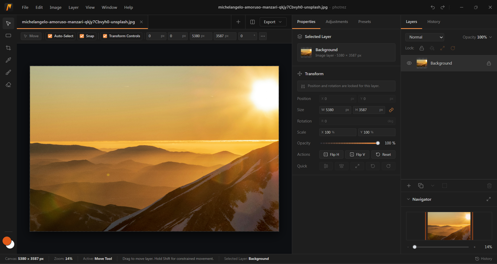

<p align="center">
  
</p>

<h1 align="center">
  <strong>Photrez</strong>
</h1>

<p align="center">
  <strong>A fast, lightweight native desktop image editor for daily graphic work.</strong><br>
  Layer management, transforms, precision selection, brush tools, and print export, built for creators who want clean, dependable editing without the bloat.
</p>

<p align="center">
  <a href="https://github.com/photrez/photrez/actions/workflows/ci.yml"></a>
  <a href="https://github.com/photrez/photrez/releases"></a>
  <a href="https://github.com/photrez/photrez/blob/main/LICENSE"></a>
  <a href="https://github.com/photrez/photrez/stargazers"></a>
  <a href="https://github.com/photrez/photrez/issues"></a>
  
  
  
</p>

---



<div align="center">

### 📦 Download Photrez

Portable archives per platform: extract and run, no installer. The native application is published as
`Photrez-v<version>-windows-x64.zip`, `Photrez-v<version>-macos-arm64.tar.gz` and
`Photrez-v<version>-linux-x64.tar.gz` from the
[releases page](https://github.com/photrez/photrez/releases).

Read the release list before you download. As of 2026-11-04 the native archive format is produced by the
release workflow but has only been published as draft releases, and the release marked **Latest** on that
page is `v0.1.0`, which ships the archived predecessor's installers (`.exe` setup, `.dmg`, `.deb`, `.rpm`,
`.AppImage`). Those are not this application. If you see a setup program or an AppImage, you are looking at
the previous implementation.

- **Windows 10/11 (64-bit):** `Photrez-v<version>-windows-x64.zip` → run `photrez.exe`
- **macOS (Apple silicon):** `Photrez-v<version>-macos-arm64.tar.gz` → run `photrez`
- **Linux (X11/Wayland, x64):** `Photrez-v<version>-linux-x64.tar.gz` → run `photrez`

On Windows, extract the archive anywhere and run `photrez.exe`. There is no installer, Start Menu entry, or file-association registration.

Each archive contains the executable, `LICENSE`, `NOTICE`, and `THIRD_PARTY.md`. The release also carries a `SHA256SUMS` file; verify the archive with `sha256sum -c SHA256SUMS`. These portable archives are unsigned. Windows SmartScreen may warn when launching `photrez.exe`; verify the archive checksum before running it.

</div>

> The previous implementation and its history are archived at [photrez/photrez-legacy](https://github.com/photrez/photrez-legacy). The current codebase is the native Rust/GPUI application.

---

## ✨ Key Features

<table>
  <tr>
    <td width="50%" valign="top">
      <h3>⚡ Native & Fast</h3>
      <p>A native Rust interface (GPUI) over the Rust <code>photrez-core</code> document engine: one process, no embedded browser, no telemetry, no forced cloud accounts.</p>
    </td>
    <td width="50%" valign="top">
      <h3>🎨 Layer & Selection Workflow</h3>
      <p>Full multi-layer management (opacity, blend, visibility, lock, duplicate, merge), marquee selection tools (rectangle & ellipse), and object transforms with snapping.</p>
    </td>
  </tr>
  <tr>
    <td width="50%" valign="top">
      <h3>🖌️ Calibrated Paint & Vector</h3>
      <p>Smooth round-tip brush and eraser with hardness, flow, and smoothing controls, alongside parametric text and shape layers.</p>
    </td>
    <td width="50%" valign="top">
      <h3>🖨️ Print & High-DPI Export</h3>
      <p>Built-in print dialog and inspector with paper presets and DPI/PPI scale calculations (Windows), and clean exports to PNG, JPEG, and WebP on every platform.</p>
    </td>
  </tr>
</table>

---

## 📁 Supported Formats

| Format | Extension | Type | Import | Export | Notes |
| --- | --- | --- | :---: | :---: | --- |
| **Photrez Project** | `.ptz` | Native Project | ✅ | ✅ | Backward-compatible from v0.1.0; current format v3, preserves full layer state & vector text |
| **PNG Image** | `.png` | Raster Bitmap | ✅ | ✅ | Full RGBA alpha channel transparency support |
| **JPEG Image** | `.jpg`, `.jpeg` | Raster Bitmap | ✅ | ✅ | Standard compressed photo format with quality controls |
| **WebP Image** | `.webp` | Raster Bitmap | ✅ | ✅ | Export is currently the lossless path (quality is ignored) |
| **BMP Image** | `.bmp` | Raster Bitmap | ✅ | ❌ | Import-only raster |

---

## ⌨️ Essential Keyboard Shortcuts

| Shortcut | Tool / Action | Description |
| --- | --- | --- |
| `V` | **Move & Transform** | Select, drag, scale, and rotate objects |
| `M` / `Shift+M` | **Marquee Selection** | Toggle between Rectangular and Elliptical marquee |
| `B` / `E` | **Brush & Eraser** | Paint strokes or erase bitmap layer pixels |
| `T` / `U` | **Text & Shape** | Add typography layers or draw vector shapes |
| `Ctrl + Z` / `Ctrl + Y` | **Undo / Redo** | History stack navigation |
| `Ctrl + P` | **Print** | Open the print dialog & inspector (Windows) |
| `Ctrl + Shift + P` | **Side Panels** | Toggle the right dock |

---

## 🖥️ Platform Notes

| Platform | Status | Print | Notes |
| --- | --- | --- | --- |
| Windows 10/11 (x64) | Supported | ✅ Native print dialog & inspector | Primary development platform |
| macOS 12+ (Apple silicon) | Supported | ❌ Unsupported (typed error) | Builds and runs |
| Linux (X11/Wayland, x64) | Supported | ❌ Unsupported (typed error) | Requires X11 or Wayland, fontconfig/FreeType, and a Vulkan or OpenGL driver |

---

## 🛠️ Building from Source

```bash
# Use the Rust toolchain specified by rust-toolchain.toml
cargo dev                          # Run the app with the dev profile (cargo run -p photrez)
cargo xtask dev                    # Same, adding the Windows GNU linker dir to the child PATH
cargo ui                           # UI iteration profile (app crate at opt-level 1)
bacon                              # Save-triggered cargo check -p photrez
cargo build --release -p photrez   # Release binary at target/release/photrez(.exe)

# Workspace validation
cargo fmt --check
cargo clippy --workspace --all-targets -- -D warnings
cargo test --workspace
```

---

## ❓ Frequently Asked Questions (FAQ)

<details>
<summary><b>Does Photrez require an internet connection or account?</b></summary>
<p>No. Photrez is 100% local-first software. It runs entirely offline on your computer without cloud accounts, telemetry, or subscriptions.</p>
</details>

<details>
<summary><b>Does Photrez support PSD files?</b></summary>
<p>Not currently. Photrez uses its versioned <code>.ptz</code> project format for layered documents and exports to PNG, JPEG, and WebP. PSD import support is on the long-term roadmap.</p>
</details>

<details>
<summary><b>What do Save, Save As, and Export do?</b></summary>
<p><b>Save</b> (<code>Ctrl+S</code>) overwrites your <code>.ptz</code> project, every layer fully re-editable later. For a new or unsaved document it opens Save As, which defaults to <code>.ptz</code>. A flat single-layer source (JPG/PNG/WebP) is overwritten in place by Save. <b>Export</b> (<code>Ctrl+Alt+E</code>) writes a separate flat PNG/JPEG/WebP copy.</p>
</details>

<details>
<summary><b>Is there autosave, and what happens after a crash?</b></summary>
<p>Yes. While you edit, Photrez writes a hidden autosave (document metadata plus pixels) at most once per minute to a local temp directory, and checks for it on the next launch. It is local-only, no cloud backup.</p>
</details>

<details>
<summary><b>What happens when I close a document with unsaved changes?</b></summary>
<p>Photrez asks <b>Discard changes?</b> Choose <b>Discard</b> to close without saving, or <b>Cancel</b> to go back. With nothing unsaved, the document closes immediately and the nearest remaining tab activates.</p>
</details>

<details>
<summary><b>What are the New Document defaults?</b></summary>
<p>The New Document dialog opens at 1080×1080 pixels on a white background, with category tabs (Paper, Social Media, Web & Video, Photography), a preset grid that includes HD (1920×1080) and A4 (2480×3508), or a custom Name/Width/Height/Unit/Background form.</p>
</details>

<details>
<summary><b>Why does the canvas look pixelated at very high zoom?</b></summary>
<p>The preview buffer is clamped to keep the GPU workload bounded, so beyond that zoom level the preview pixelates. Pan to inspect other regions instead of zooming further.</p>
</details>

<details>
<summary><b>Any other known limitations?</b></summary>
<p>Printing is Windows-only in this release (see the platform notes above). The artifacts are not code-signed. Verify the SHA256 checksums. For anything else, GitHub Issues is the live channel for bugs.</p>
</details>

---

## 📚 Documentation

- 🏗️ **[Architecture](docs/ARCHITECTURE.md)**: runtime architecture
- 📋 **[Feature Matrix](docs/FEATURES.md)**: What the current native app does, by product area
- 🤝 **[Contributing](CONTRIBUTING.md)**: PR & code guidelines
- 🔒 **[Security Policy](SECURITY.md)**: Vulnerability reporting

---

## 📄 License

Photrez is open-source software licensed under **AGPL-3.0-or-later**. See the [LICENSE](LICENSE) file for details.
